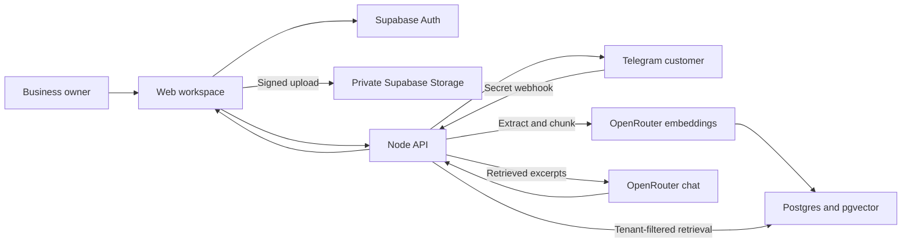

# TeleRAG

Turn business documents into source-backed customer support answers in a web workspace and on Telegram.

TeleRAG is an MVP built with Node.js, Supabase Auth/Storage/Postgres, pgvector, and OpenRouter. The landing page includes an interactive, scripted demo that works without an account or API keys.

## Features

- Email/password accounts, session renewal, email confirmation callbacks, and password recovery
- One isolated business workspace per account, with an editable business name
- Private direct-to-storage uploads: PDF, DOCX, CSV, TXT, and Markdown, up to 10 MiB each
- Text extraction, overlapping chunks, batched 768-dimensional embeddings, and vector retrieval from ready documents
- Grounded answers with checked source references; unsupported answers are recorded for review
- Document status, indexing errors, interrupted-job recovery, retry, and deletion
- Owner dashboard with passage counts, monthly usage, recent conversations, and unanswered-question review
- Telegram bot connection, encrypted tokens, authenticated webhooks, duplicate-update protection, source labels, and a generated `/start` welcome message
- Atomic database limits: 5 question attempts per chat/minute, 30 per workspace/minute, and 1,000 per workspace/UTC month
- Automated API, authentication, Telegram, and PostgreSQL/pgvector tests, plus GitHub Actions CI

## Run locally

Requires Node.js **22.13 or later** and a Supabase project.

```powershell
npm ci
Copy-Item .env.example .env
```

Fill in `.env`, then configure the private storage bucket:

```powershell
npm run setup:supabase
```

Apply the SQL files in `supabase/migrations/` in numeric order using the Supabase SQL Editor. For an existing installation with migrations 0001 and 0002 already applied, apply **only `0003_workspace_release.sql`**. SQL setup is separate from storage setup.

Enable email/password authentication. Set your Supabase Auth site URL and redirect allowlist to include `http://localhost:3000/workspace` and your deployed `/workspace` URL. If email confirmation is enabled, follow the confirmation link before signing in. Password recovery also uses this redirect configuration.

```powershell
npm run doctor
npm run dev
```

Open [the workspace](http://localhost:3000/workspace), create an account, and upload [the sample handbook](examples/studio-handbook.md). Ask: “How much is the beginner pottery class?”

## Verify

```powershell
npm run check
```

This runs TypeScript checking, the full test suite, and the static build. Tests use mocked external APIs and a local WASM PostgreSQL engine with pgvector; they require no production credentials and make no paid AI calls. Database tests execute the actual migrations and verify RLS, vector isolation, rate limits, monthly usage, and cascading deletion.

The optional `npm run smoke:providers` command uses your configured OpenRouter account for one embedding request and one short answer using synthetic text. It may incur a small provider charge.

`npm run doctor` checks environment configuration, deployed schema, private storage, and the allowance RPC without printing credentials. `/api/health` checks configuration/liveness; it does not prove external providers are available.

## Deploy and connect Telegram

See [the deployment guide](docs/DEPLOYMENT.md) for the release sequence and live checks. Vercel serves `dist/` and runs the API from `api/[...path].mjs`, with an explicit Telegram webhook function. Uploaded bytes bypass Vercel and go directly to private Supabase Storage.

Create a bot with [BotFather](https://t.me/BotFather), set `TELEGRAM_WEBHOOK_BASE_URL` to the deployed public HTTPS origin, and connect its token in the workspace. After indexing your documents, the welcome panel provides a copyable paragraph. The bot sends that greeting on `/start` without an AI call.

## Architecture and scope



Embedding dimension is fixed at 768. The default embedding model is `thenlper/gte-base`; the chat default is `qwen/qwen3.8-27b`, overridable through environment variables. Use the same embedding model for indexing and queries; changing it requires reindexing documents. Pricing and availability depend on OpenRouter and its providers.

Documents are limited to 160 chunks to bound synchronous indexing work. Files with no extractable text fail with a retryable status; scanned PDFs need OCR before upload. Bot-token encryption derives its key from the Supabase service-role key, so rotating that key requires reconnecting bots. Session credentials stay in tab-scoped session storage. Extracted text and questions are sent to OpenRouter for indexing and answers.

This release excludes Excel workbook extraction, image OCR, payments, subscriptions, team accounts, a platform administrator panel, and a durable background job queue. The dashboard belongs to the business owner. Usage caps count reserved question attempts, including provider failures; they are safeguards rather than billing. Webhook retries are deduplicated after successful delivery, but an ambiguous delivery failure can still produce a repeated reply.

See [the project overview](docs/PROJECT_OVERVIEW.md) and [LinkedIn draft](docs/LINKEDIN_POST.md) for sharing the project.
