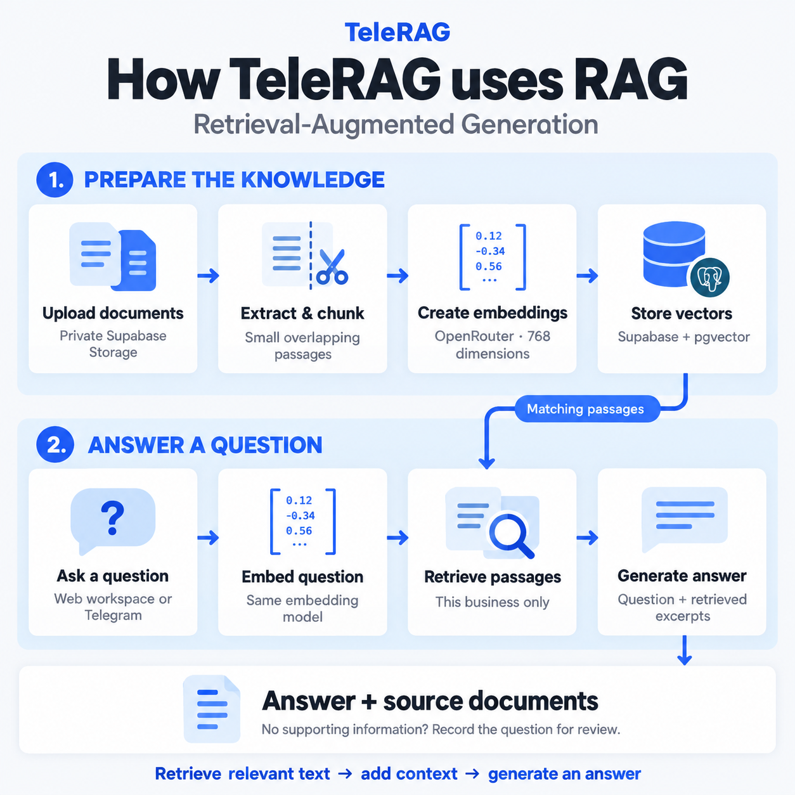
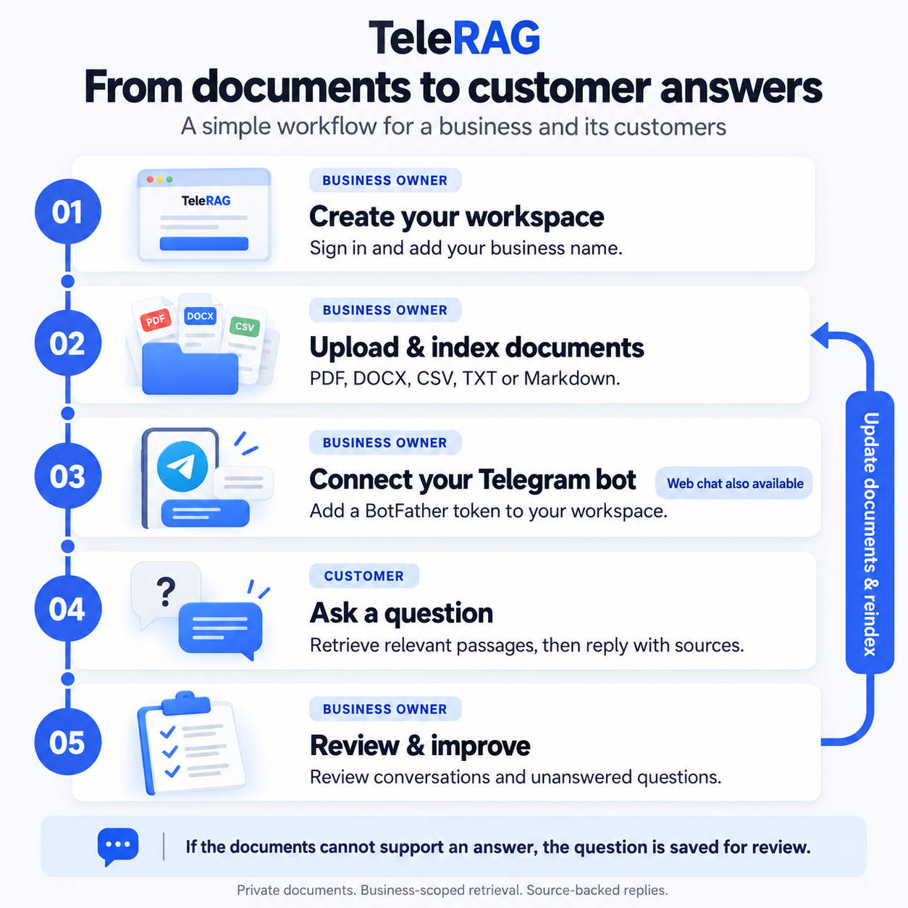

<div align="center">


# TeleRAG

### Your business knowledge, in conversation.

Turn handbooks, price lists, and policies into source-backed answers in your workspace and on Telegram.


[Features](#what-you-can-do) · [How it works](#how-it-works) · [Quick start](#quick-start) · [Deployment](#deployment) · [Documentation](#documentation)

</div>

<br />


<p align="center"><sub>The public demo uses fictional sample documents and scripted answers. The authenticated workspace runs the full RAG pipeline.</sub></p>

<details>
<summary><strong>Explore the dark theme and workspace</strong></summary>


</details>

## What you can do

TeleRAG brings document management, retrieval-augmented generation, and customer conversations into one workspace.

| Capability | What it gives you |
| --- | --- |
| **A private knowledge base** | Upload PDF, DOCX, CSV, TXT, and Markdown directly to private Supabase Storage. |
| **Answers with sources** | Retrieve relevant document passages, generate an answer, and see the supporting file names. |
| **Natural customer replies** | Generate replies from your retrieved document content, adapting to the business and question without industry-specific reply templates. Missing information is acknowledged naturally and saved for review. |
| **A connected Telegram bot** | Connect a BotFather token, generate a welcome message, and answer customer questions from the same documents. |
| **Document controls** | Track indexing status, inspect errors, retry interrupted jobs, and delete files and their indexed passages. |
| **An owner dashboard** | Review recent conversations, monthly usage, searchable passage counts, and unanswered questions. |
| **Account and usage controls** | Email/password sign-in, session renewal, password recovery, tenant isolation, and atomic request limits. |
| **A considered React interface** | Responsive layouts, saved light/dark themes, scroll progress, gentle reveals, and a scroll-driven RAG walkthrough. Motion respects reduced-motion preferences. |

## How it works

### Prepare the knowledge

**Upload → extract text → create overlapping chunks → embed → store in pgvector**

Files upload directly from the browser to private storage using a signed URL. The server extracts text, creates small overlapping passages, and batches embedding requests through OpenRouter. Each document and its chunks belong to a single business workspace.

### Answer a question

**Question → embed → retrieve relevant passages → generate → return answer + sources**

The API checks the question allowance, embeds the question with the same model used for indexing, and retrieves passages from that business's ready documents. The chat model receives the question and retrieved excerpts. The server validates the returned source numbers before presenting the answer. Questions without supporting information are saved for the owner to review.

<details>
<summary><strong>View the RAG system diagram</strong></summary>

<br />



</details>

<details>
<summary><strong>View the business and customer workflow</strong></summary>

<br />



</details>

## Quick start

### 1. Install the project

You need **Node.js 22.13 or later**, a Supabase project, and an OpenRouter API key. A Telegram bot and a public HTTPS deployment are needed only for Telegram integration.

```sh
git clone --branch final-touches https://github.com/Thesaru-p/tele-rag.git
cd tele-rag
npm ci
```

### 2. Configure the environment

Copy [`.env.example`](.env.example) to `.env` and replace the placeholders with your project values.

```dotenv
SUPABASE_URL=https://<PROJECT_REF>.supabase.co
SUPABASE_ANON_KEY=<ANON_KEY>
SUPABASE_SERVICE_ROLE_KEY=<SERVICE_ROLE_KEY>

OPENROUTER_API_KEY=<OPENROUTER_API_KEY>
OPENROUTER_CHAT_MODEL=qwen/qwen3.8-27b
OPENROUTER_EMBEDDING_MODEL=thenlper/gte-base

# Required only for Telegram: use your deployed public HTTPS origin.
TELEGRAM_WEBHOOK_BASE_URL=https://<YOUR_PUBLIC_APP_DOMAIN>
```

The service-role and OpenRouter keys are server-side credentials. Keep them in `.env` or your deployment's environment settings; `.env` is ignored by Git.

### 3. Set up storage and the database

Create or configure the private document bucket:

```sh
npm run setup:supabase
```

Then run these files in the **Supabase SQL Editor**, in order:

1. [`0001_initial.sql`](supabase/migrations/0001_initial.sql) — tables, row-level security, and pgvector.
2. [`0002_telegram_bots.sql`](supabase/migrations/0002_telegram_bots.sql) — encrypted bot credentials and webhook configuration.
3. [`0003_workspace_release.sql`](supabase/migrations/0003_workspace_release.sql) — document diagnostics, conversation sources, and usage controls.

**Upgrading an existing installation?** If 0001 and 0002 are already applied, run only 0003. The storage command does not apply SQL migrations.

### 4. Configure authentication

Enable email/password sign-in in Supabase Auth. Set the Site URL for your application and include `http://localhost:3000/workspace` in the redirect allowlist. Add the deployed `/workspace` URL when you deploy. Email confirmation and password recovery use this configuration.

### 5. Start the application

```sh
npm run doctor
npm run dev
```

Open [localhost:3000](http://localhost:3000) for the public demo or [localhost:3000/workspace](http://localhost:3000/workspace) for your account.

Create an account, upload [the sample studio handbook](examples/studio-handbook.md), and ask:

> How much is the beginner pottery class?

You should receive an answer based on the handbook, with its file name shown as a source.

## Connect Telegram

1. Create a bot with [BotFather](https://t.me/BotFather) and copy its token.
2. Deploy TeleRAG to a public HTTPS URL and set `TELEGRAM_WEBHOOK_BASE_URL` to that origin.
3. Paste the token into the Telegram section of your signed-in workspace.
4. Open the bot, send `/start`, and ask a question about your indexed documents.

The workspace generates a copyable welcome paragraph after your documents are ready. The bot sends the same greeting on `/start` without an AI request. Telegram webhooks verify a secret header and protect against duplicate updates after successful delivery.

## Development and verification

| Command | Purpose |
| --- | --- |
| `npm run dev` | Run Vite with React hot reload and the Node API on port 3000. |
| `npm run check` | Check backend/frontend types, run API/database and React tests, and build for production. |
| `npm test` | Run API, session, Telegram, and database tests. |
| `npm run test:ui` | Run React interaction, theme, and browser API-client tests with Vitest. |
| `npm run doctor` | Check environment configuration, remote schema, private storage, and the allowance RPC. |
| `npm run build` | Bundle both React pages and their assets into `dist/` with Vite. |
| `npm run preview` | Serve the built site with the Node API. |
| `npm run smoke:providers` | Verify the configured embedding and chat providers using synthetic text. |

Automated tests mock external APIs and execute the actual SQL migrations against a local PostgreSQL engine with pgvector. They cover tenant isolation, RLS, citations, indexing recovery, session refresh, Telegram handling, rate limits, and cascading deletion. React tests additionally cover demo citations/reset, theme persistence, recovery callbacks, and rejected or stale sessions. They require no production credentials or paid AI calls. [GitHub Actions](.github/workflows/ci.yml) runs the same checks on pushes and pull requests.

The frontend lives in [`website/src/`](website/src/). The public landing page and authenticated workspace are separate, lazily loaded React entries. Vite emits `index.html` and `workspace.html`, preserving the `/` and `/workspace` routes for Vercel clean URLs. Theme initialization runs before React paints. The API and database migrations remain server-side.

For browser checks without production credentials, run `npm run build`, then `node scripts/test-support/browser-server.mjs`. Open [the isolated workspace](http://localhost:3100/workspace) and sign in with `demo@example.invalid` and any password of at least eight characters. This fixture uses in-memory data and mocked providers; it never loads `.env` or contacts production services. It serves the latest build and resets when restarted.

The optional provider smoke test makes real OpenRouter requests and may incur a small charge. `/api/health` reports configuration/liveness; it does not check provider availability.

## Built with

| Layer | Technology |
| --- | --- |
| Interface | React, TypeScript, CSS, and Vite |
| API | Node.js and JavaScript modules |
| Authentication and storage | Supabase Auth and private Supabase Storage |
| Retrieval | PostgreSQL, pgvector, and 768-dimensional embeddings |
| AI providers | OpenRouter embeddings and chat |
| Customer channel | Telegram Bot API |
| Verification | Vitest, React Testing Library, Node's test runner, TypeScript, PGlite, and GitHub Actions |
| Deployment | Vercel static hosting and Node functions |

## Deployment

Vercel serves the built site from `dist/` and runs the API through Node functions. Upload bytes go directly to Supabase Storage, keeping document uploads out of function request bodies.

Follow the [deployment guide](docs/DEPLOYMENT.md) for environment settings, migrations, authentication redirects, Telegram setup, and live verification. Apply database migrations before deploying code that depends on them.

## Scope and limits

- **Customer actions:** the assistant explains procedures described in your documents but does not submit orders, reserve appointments, check live stock, take payments, or notify staff. Conversation follow-ups should include the item or service being discussed; replies currently use the current question rather than conversation history. A generic unavailable-information reply is used when there are no ready documents or generated citations are invalid.
- **Workspace:** one business owner per account; the dashboard is scoped to that owner's business.
- **Documents:** supported text-based formats, up to **10 MiB** and **160 chunks** per file. Scanned PDFs need OCR before upload; image OCR and Excel workbooks are not supported.
- **Questions:** **5 attempts per chat/minute**, **30 per workspace/minute**, and **1,000 per workspace/UTC month**. Reserved attempts count even when a provider fails; rejected requests do not increase the counter.
- **Embeddings:** fixed at **768 dimensions**. Changing the embedding model requires reindexing documents, using the same model for queries and indexing.
- **Credentials and data:** bot tokens are encrypted using a key derived from the service-role key. Reconnect bots after rotating that key. Browser sessions use tab-scoped session storage. OpenRouter processes extracted text and questions.
- **MVP boundaries:** no payment collection, subscriptions, team accounts, platform-wide administrator console, or durable background queue. Ambiguous Telegram delivery failures can still produce repeated replies.

## Documentation

- [Project overview](docs/PROJECT_OVERVIEW.md) — the problem, implementation, and engineering decisions.
- [Deployment guide](docs/DEPLOYMENT.md) — configuration, release steps, and troubleshooting.
- [Verification report](docs/VERIFICATION.md) — completed checks and remaining live release checks.
- [Sample handbook](examples/studio-handbook.md) — fictional business information for trying the application.
