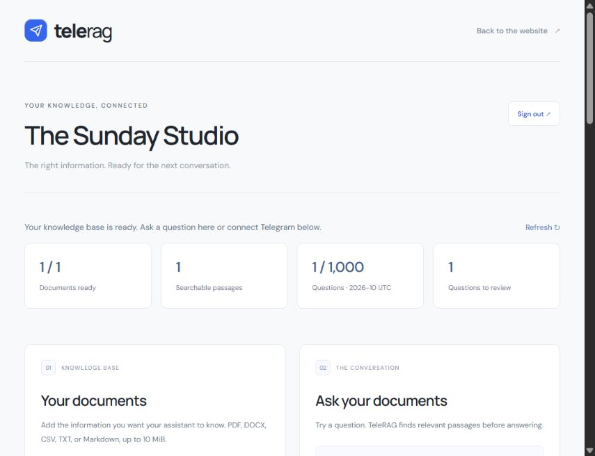
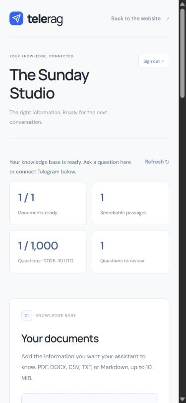
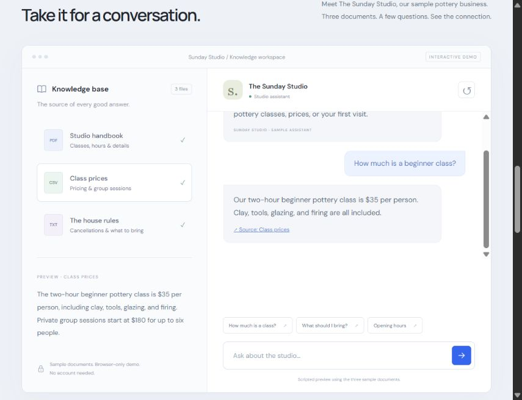

# Verification — 27 October 2026

## Passed locally

- `npm run check`: TypeScript checking, **30 tests**, and the production static build.
- Actual SQL migrations executed against local PostgreSQL with pgvector. Tests cover RLS, tenant-filtered retrieval from ready files, per-chat/workspace/minute limits, UTC monthly allowances, and cascading chunk deletion.
- Mocked API tests cover verified authentication, metadata validation, tenant boundaries, direct-upload finalization, indexing failures/retries, checked citations, unanswered-question review, dashboard queries, Telegram sources/secrets/deduplication, and limit responses.
- Session tests cover concurrent refresh, token rotation, expired refresh credentials, sign-out during refresh, and a newer sign-in during refresh.
- Existing welcome-message and Telegram retry tests passed.
- Live OpenRouter smoke test: the configured embedding model returned 768 dimensions; the configured chat model returned a supported structured answer with the correct source. Only fictional sample text was sent.
- Browser checks with isolated mock services: sign-in, persisted session after reload, business settings, cited answers, unsupported-answer review, delete confirmation/cancel, sign-out, and password-recovery email validation.
- Public demo checked on the final local server: sample answer and its source button select the matching document preview.
- Desktop and 390px mobile views inspected. Mobile had no horizontal overflow. No browser warning/error logs were captured in the fixture checks.
- Production dependency audit reported zero vulnerabilities.

## Release setup deferred by the owner

The owner chose to finish the local project and deploy later. The existing Supabase project has migrations 0001 and 0002 but needs 0003; `npm run doctor` correctly reports the missing columns, usage table, and allowance RPC. The saved Vercel CLI login is expired. No production migration or deployment was performed.

The local `.env` chat-model setting was changed from an unavailable free endpoint to `qwen/qwen3.8-27b`, matching the existing code default. Configure the same working model in the deployment environment.

Live signup/email recovery, document ingestion against the upgraded remote schema, and Telegram delivery from the upgraded deployment remain release checks in [DEPLOYMENT.md](DEPLOYMENT.md).

## Screenshots

These screenshots show fictional sample data from an isolated local test server. They are UI verification evidence, not screenshots of production customers or a live Telegram connection.

The public scripted demo on the final local server:

