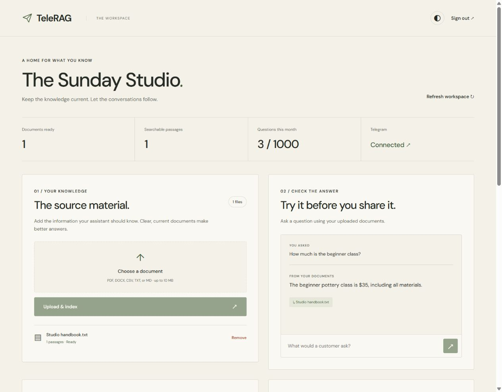
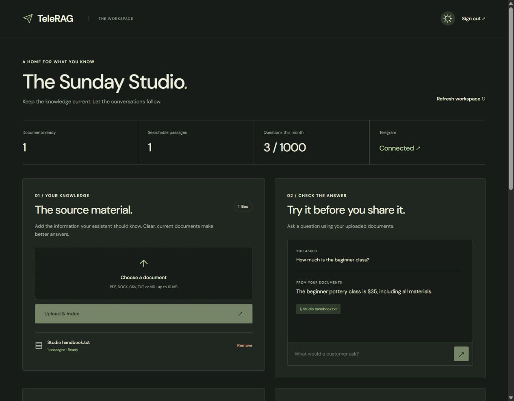
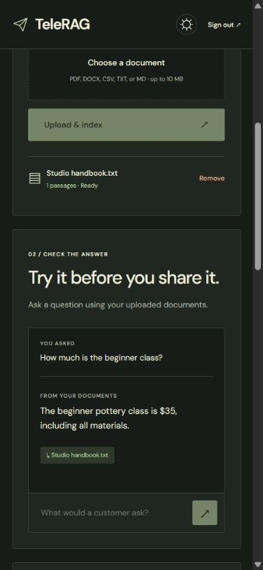
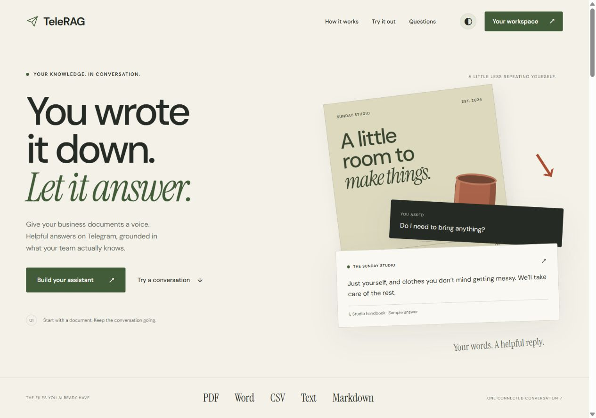
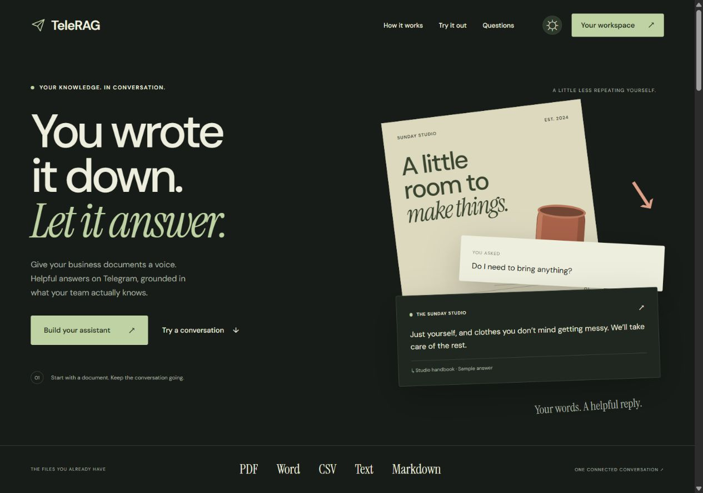
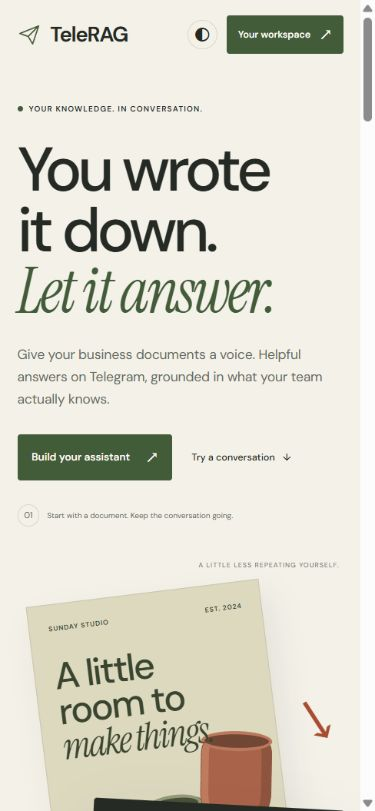

# Verification — 27 October 2026

## Deployment routing fix — 28 October 2026

- Production diagnostics confirmed that `/api/documents/upload-url`, `/api/documents/finalize-upload`, and `/api/documents/:id/reindex` returned Vercel plain-text 404s. `/api/chat` returned the expected JSON 401 without credentials. The upload requests never reached the function.
- Added explicit Vercel entrypoints for upload preparation, finalization, document deletion, reindexing, and unanswered-question review. Each delegates to the existing authenticated API.
- Local checks now cover 41 tests, including a regression check that all five nested entrypoints return authenticated API JSON. Live upload/retry verification remains pending deployment of this fix.
- `npm run check` passed. Vercel's separate local packaging command could not complete on this Windows host (`spawn cmd.exe ENOENT`); the cloud build and generated deployment routes still need verification before the fix is considered released.

## Passed locally

- `npm run check`: backend/frontend TypeScript checking, **40 tests** (30 API/database/session/Telegram and 10 React/client tests), and the Vite production build.
- Actual SQL migrations executed against local PostgreSQL with pgvector. Tests cover RLS, tenant-filtered retrieval from ready files, per-chat/workspace/minute limits, UTC monthly allowances, and cascading chunk deletion.
- Mocked API tests cover verified authentication, metadata validation, tenant boundaries, direct-upload finalization, indexing failures/retries, checked citations, unanswered-question review, dashboard queries, Telegram sources/secrets/deduplication, and limit responses.
- Session tests cover concurrent refresh, token rotation, expired refresh credentials, sign-out during refresh, and a newer sign-in during refresh.
- Existing welcome-message and Telegram retry tests passed.
- React tests cover source selection, pending-demo cancellation, unsupported sample questions, theme persistence with blocked-storage fallback, recovery navigation/callback handling, initialization under repeated effects, and rejected/stale authenticated responses.
- Live OpenRouter smoke test: the configured embedding model returned 768 dimensions; the configured chat model returned a supported structured answer with the correct source. Only fictional sample text was sent.
- React browser checks with isolated mock services: sign-in, persisted session after reload, business settings, cited answers, unsupported-answer review, direct file upload and indexing, delete confirmation/cancel/removal, Telegram connection UI, welcome copying, and sign-out. Bot/API/provider calls in these checks are mocked; no live Telegram connection is implied.
- Public demo checked on the final local server: sample answer and its source button select the matching document preview.
- Light and dark desktop layouts plus 390px mobile layouts inspected. The landing page was also checked at 320px. No horizontal overflow was found. Theme switching, source previews, scroll progress, and walkthrough updates were checked. Decorative motion has a reduced-motion fallback. No browser warning/error logs were captured in the React workspace fixture checks.
- Production dependency audit reported zero vulnerabilities.

## Release setup deferred by the owner

The owner chose to finish the local project and deploy later. The existing Supabase project has migrations 0001 and 0002 but needs 0003; `npm run doctor` correctly reports the missing columns, usage table, and allowance RPC. The saved Vercel CLI login is expired. No production migration or deployment was performed.

The local `.env` chat-model setting was changed from an unavailable free endpoint to `qwen/qwen3.8-27b`, matching the existing code default. Configure the same working model in the deployment environment.

Live signup/email recovery, document ingestion against the upgraded remote schema, and Telegram delivery from the upgraded deployment remain release checks in [DEPLOYMENT.md](DEPLOYMENT.md).

## Screenshots

These screenshots show fictional sample data from an isolated local test server. They are UI verification evidence, not screenshots of production customers or a live Telegram connection.

The redesigned React landing page:

